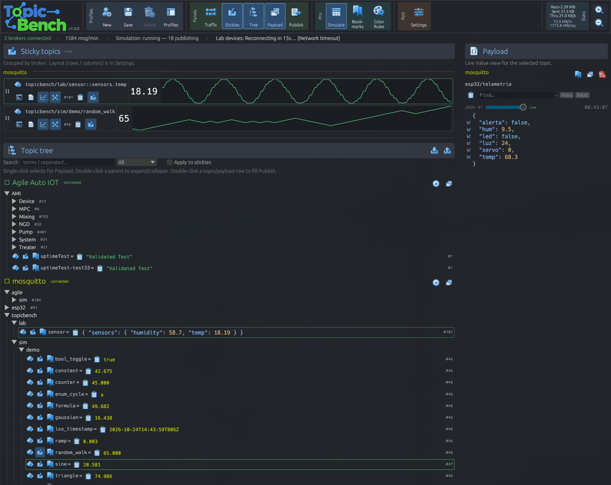

# TopicBench

Free, open-source MQTT explorer and monitor for builders and testers.

<p align="center">
  
</p>

## Why TopicBench

- **Simultaneous multi-broker** — connect to several brokers at once and monitor or search their topics in a single window
- **Multi-broker profiles** — save hosts, TLS/WSS options, and credentials (passwords in the OS keyring)
- **Live topic tree** — subscribe with wildcards and browse traffic as it arrives
- **Publish & recent** — send messages quickly and keep recent payloads handy
- **Payload inspect** — clear views for JSON and plain text
- **Stickies & graphs** — pin important topics and watch values over time
- **Search** — find topics and payloads without leaving the desktop UI
- **Free & open source** — use it, fork it, ship it
- **Updates via GitHub Releases** — in-app check when releases are published

## Features

- Connection profiles (MQTT TCP / WebSocket, optional TLS)
- Concurrent live sessions across brokers in one window
- Topic subscriptions with `+` / `#`
- Shared sticky board across profiles
- Publish with QoS and retain
- Compact ribbon layout that adapts to window width
- Settings for panels, fonts, and update preferences

## Download

Grab builds from **[GitHub Releases](https://github.com/unipsycho/topicbench/releases)** when published.

Repo: [github.com/unipsycho/topicbench](https://github.com/unipsycho/topicbench)

## Build from source

**Requirements:** Rust stable ≥ 1.80 (`rustup update stable`), plus Linux GUI libs (typically `libxcb`, `libxkbcommon`, and a Vulkan/GL stack).

```bash
git clone https://github.com/unipsycho/topicbench.git
cd topicbench
cargo run --release
```

Profiles: `~/.config/mqtt-monitor/profiles.json`  
Settings: `~/.config/mqtt-monitor/settings.json`

**Windows:** native `cargo build --release` on Windows works; the Windows icon is embedded via `winres` (MinGW `windres` when cross-compiling from Linux).

## License

MIT OR Apache-2.0 (see `Cargo.toml`).
