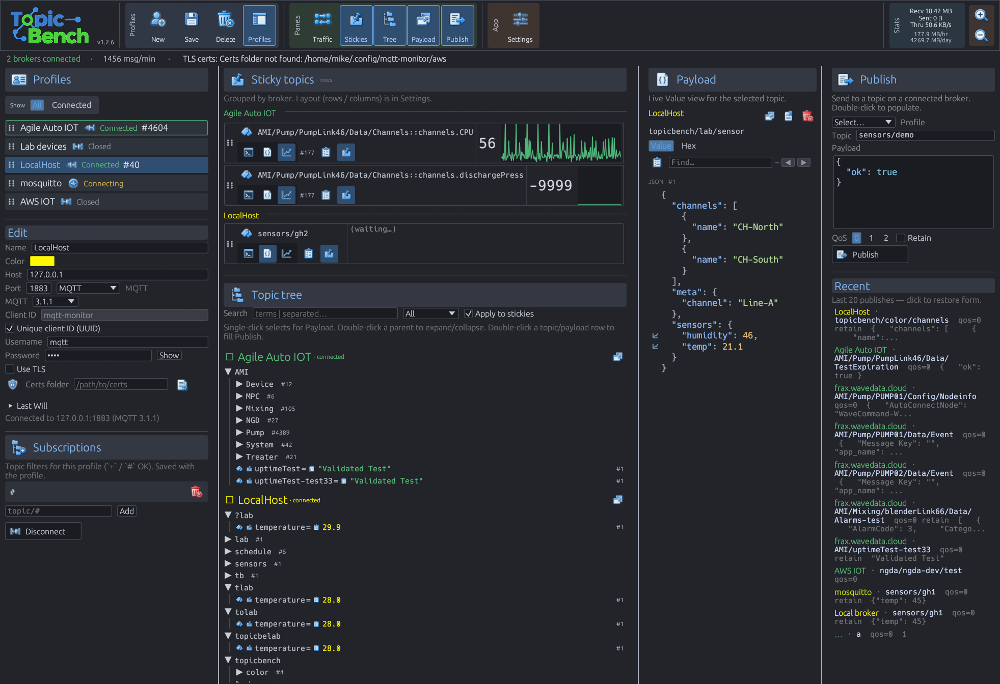
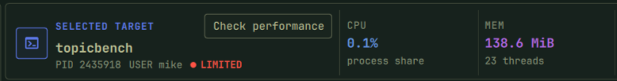
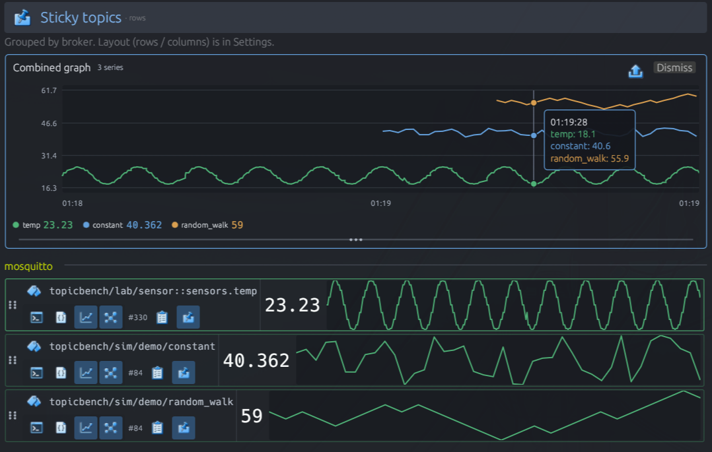
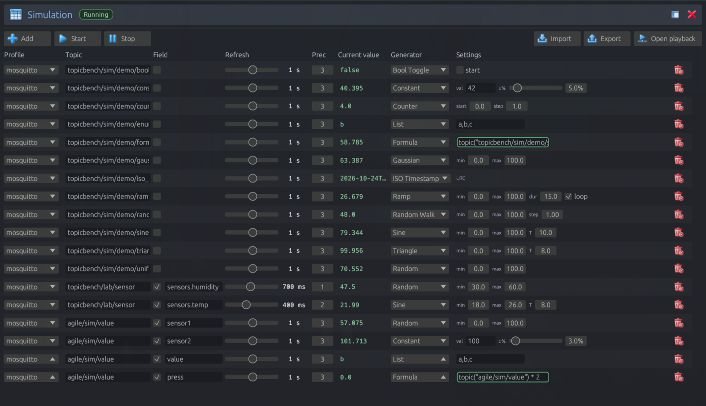
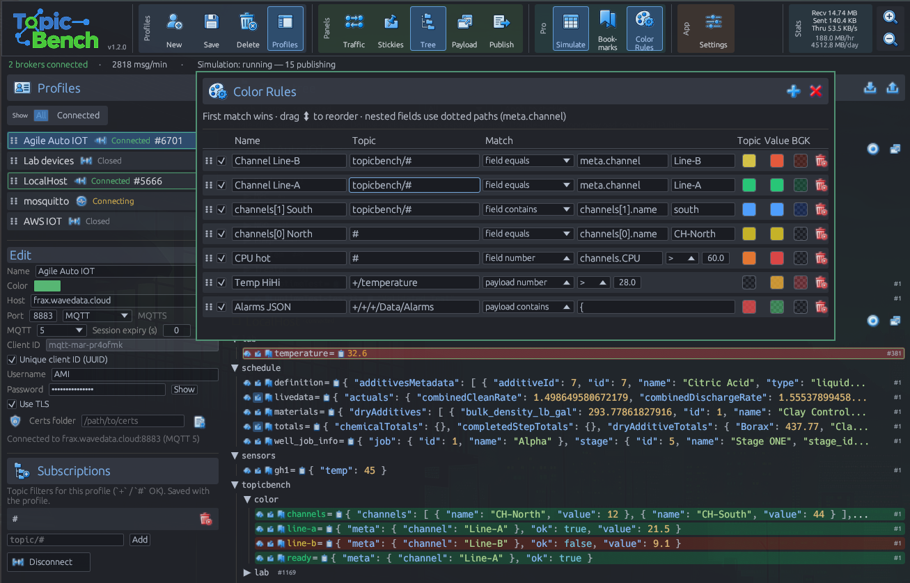
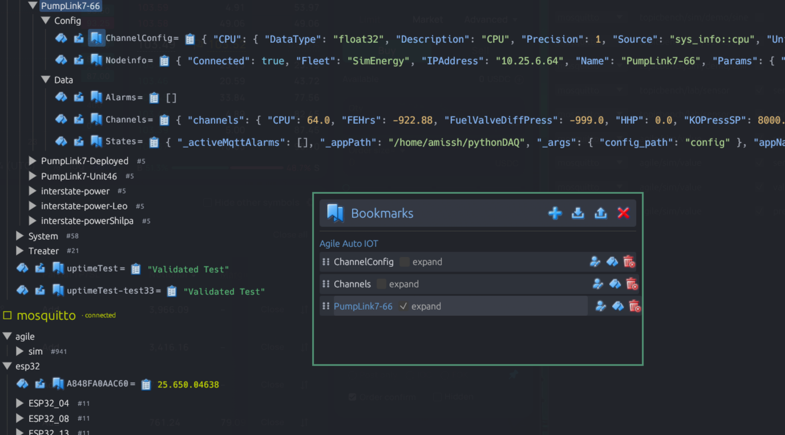

# TopicBench

Free, open-source MQTT explorer and monitor for builders and testers.

<p align="center">
  
</p>

## Why TopicBench

I use MQTT brokers every day for apps and controls. Existing tools never quite delivered easy navigation, multi-broker handling, data simulation, highlighting and searching content, or flexible windowing — moving panels around and keeping multiple topic trees in view. TopicBench’s features grew from those daily needs.

I'm happy with the performance: among the MQTT desktop tools I've tried, TopicBench stays ahead on CPU, memory, and small download size — a native Rust app that keeps large topic trees responsive without a heavy footprint.

<p align="center">
  
</p>

- **Simultaneous multi-broker** — connect to several brokers at once and monitor or search their topics in a single window
- **Multi-broker profiles** — save hosts, TLS/WSS options, and credentials (passwords in the OS keyring)
- **Live topic tree** — subscribe with wildcards and browse traffic as it arrives; keep multiple trees in view
- **Flexible windowing** — move panels and arrange the layout for how you work
- **Search & highlight** — find topics and payloads without leaving the desktop UI
- **Publish & recent** — send messages quickly and keep recent payloads handy
- **Payload inspect** — clear views for JSON and plain text
- **Stickies & graphs** — pin important topics and watch values over time
- **Free & open source** — use it, report issues, contribute
- **Updates via GitHub Releases** — in-app check for every install; bare Linux/Windows binaries can self-replace
- **100% Rust** — built entirely in Rust for efficient memory and CPU use on large topic trees and lists

## Features

- Connection profiles (MQTT TCP / WebSocket, optional TLS)
- Concurrent live sessions across brokers in one window
- Topic subscriptions with `+` / `#`
- Shared sticky board across profiles
- Publish with QoS and retain
- Full keyboard shortcuts & navigation — F1 / `?` help, panel toggles, search focus, and more

## Download

Latest free release: **[v1.2.7](https://github.com/unipsycho/topicbench/releases/tag/v1.2.7)** — typical asset sizes below (from that release).

| | | Typical size |
|:--|:--|:--|
| **Windows** portable (x64) | [TopicBench-windows-x64-portable.zip](https://github.com/unipsycho/topicbench/releases/download/v1.2.7/TopicBench-windows-x64-portable.zip) | ~17 MB |
| **Windows** exe (x64) | [topicbench-windows-x64.exe](https://github.com/unipsycho/topicbench/releases/download/v1.2.7/topicbench-windows-x64.exe) | ~35 MB |
| **Linux** binary (x64) | [topicbench-linux-x64](https://github.com/unipsycho/topicbench/releases/download/v1.2.7/topicbench-linux-x64) | ~30 MB |
| SHA-256 checksums | [SHA256SUMS](https://github.com/unipsycho/topicbench/releases/download/v1.2.7/SHA256SUMS) | |

Windows: unzip the portable zip and run `TopicBench.exe`, or use the standalone `.exe`.
Linux: canonical download is the bare **`topicbench-linux-x64`** binary (glibc **2.35+** — Ubuntu 22.04 / Debian 12 and newer). No AppImage / `.deb` / `.rpm` on Releases.

**Updates:** the bare **Linux binary** and **Windows** portable / bare `.exe` can apply updates in place (download → verify SHA-256 → replace their own files).

[All releases](https://github.com/unipsycho/topicbench/releases) · [Source on GitHub](https://github.com/unipsycho/topicbench)

## TopicBench Pro

Paid extras for teams that outgrow the free explorer — same app, unlock Pro when you need them. Standalone download for licensed customers; the free app stays unrestricted for base features. Product page: **[TopicBench Pro](https://www.agileautomation.ca/products/topic-bench)**.

- **MCP server** — connect, subscribe, publish, and wait from Cursor / CI against live sessions
- **Topic & payload simulation** — generators and formulas for whole payloads or JSON fields
- **Record → simulate** — capture live traffic, then suggest Simulate rows from the tape
- **Scenario player** — sequenced, timed multi-topic publish scripts
- **Combined multi-topic graph** — shared time axis across Graph stickies
- **History scrubber** — scrub per-topic history in the Payload panel
- **Topic bookmarks** — jump list into deep trees
- **Custom color rules** — paint tree rows by topic / payload predicates
- **UI themes** — pick a look that’s easier on the eyes or fits your environment
- **Topic tree export & import** — JSON hierarchy out, republish onto a target broker
- **CSV recording** — time-series dumps for Excel

Video summaries — click a thumbnail to watch:

<p align="center">
  <a href="https://www.agileautomation.ca/videos/topicbench-scenario-color.mp4"></a>
  &nbsp;
  <a href="https://www.agileautomation.ca/videos/topicbench-simulation-mcp.mp4"></a>
  &nbsp;
  <a href="https://www.agileautomation.ca/videos/topicbench-themes.mp4"></a>
</p>
<p align="center">
  <a href="https://www.agileautomation.ca/videos/topicbench-scenario-color.mp4">Scenario player & color rules</a>
  ·
  <a href="https://www.agileautomation.ca/videos/topicbench-simulation-mcp.mp4">Simulation & MCP agent</a>
  ·
  <a href="https://www.agileautomation.ca/videos/topicbench-themes.mp4">Themes</a>
</p>

### Combined graphs

Combined graphs let you overlay multiple channels on a single time-logged graph — useful for correlating data across topics and even across brokers.

<p align="center">
  
</p>

### Simulation

Simulation publishes scripted MQTT data into your live sessions. You can also auto-create simulations from recorded sessions to replicate datasets with a best-guess prediction of the observed series.

<p align="center">
  
</p>

### Color rules

Color rules highlight topics in the tree based on payload matches, topic matches, and individual values within payloads.

<p align="center">
  
</p>

### Bookmarks

Bookmarks jump you anywhere in a tree and auto-expand that topic for immediate access.

<p align="center">
  
</p>

<p align="center">
  <a href="https://www.agileautomation.ca/products/topic-bench"><strong style="font-size: 1.5em">Learn about TopicBench Pro →</strong></a>
</p>

## Build from source

**Requirements:** Rust stable ≥ 1.80 (`rustup update stable`), plus Linux GUI libs (typically `libxcb`, `libxkbcommon`, and a Vulkan/GL stack).

```bash
git clone https://github.com/unipsycho/topicbench.git
cd topicbench
cargo run --release
```

Profiles: `~/.config/topicbench/profiles.json`  
Settings: `~/.config/topicbench/settings.json`

**Windows:** native `cargo build --release` on Windows works; the Windows icon is embedded via `winres` (MinGW `windres` when cross-compiling from Linux).

## License

MIT OR Apache-2.0. See [`LICENSE-MIT`](LICENSE-MIT) and [`LICENSE-APACHE`](LICENSE-APACHE).
